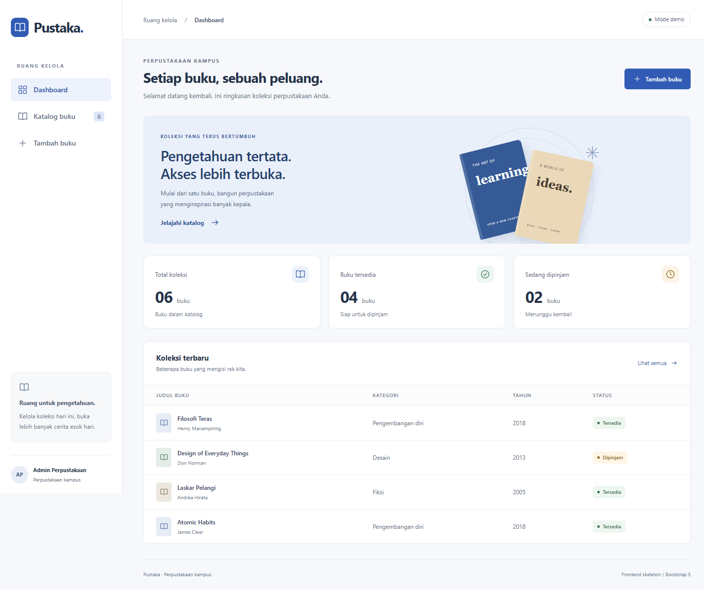
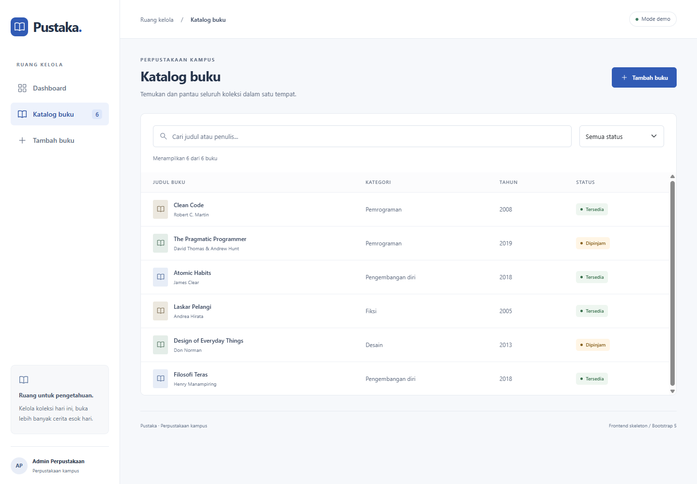
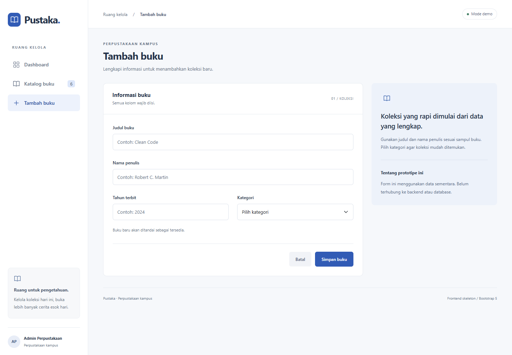
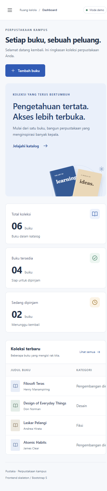
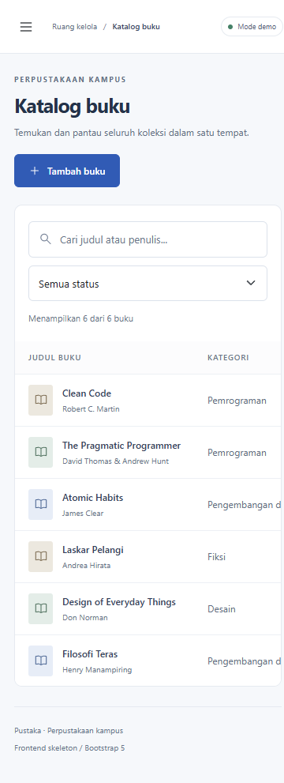
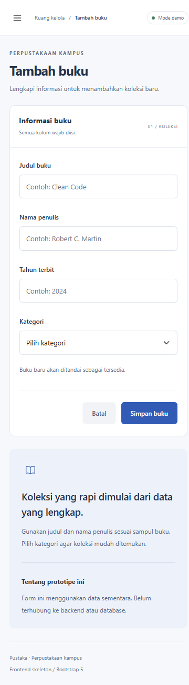

# Pustaka — Perpustakaan Kampus

Pustaka adalah aplikasi pengelolaan koleksi perpustakaan kampus. Proyek ini akan dikembangkan bertahap menjadi aplikasi fullstack sampai pekan ke-14. Tahap ini menyediakan frontend skeleton menggunakan React, Vite, dan Bootstrap 5.

## Studi kasus dan ruang lingkup

Admin perpustakaan membutuhkan tempat untuk melihat ringkasan koleksi, mencari buku, memantau ketersediaan, dan menambahkan buku. Prototipe menggunakan enam buku contoh dalam state React. Tidak ada koneksi backend, database, atau API eksternal. Buku tambahan hilang saat halaman dimuat ulang.

## Halaman dan fitur

| Halaman      | URL lokal                          | Isi                                                                         |
| ------------ | ---------------------------------- | --------------------------------------------------------------------------- |
| Dashboard    | `http://localhost:5173/#dashboard` | Banner, grid ringkasan total/tersedia/dipinjam, tabel koleksi terbaru       |
| Katalog buku | `http://localhost:5173/#katalog`   | Tabel koleksi, pencarian judul/penulis, filter status, kondisi hasil kosong |
| Tambah buku  | `http://localhost:5173/#tambah`    | Form judul, penulis, tahun, kategori, validasi, pesan berhasil              |

Sidebar tampil pada desktop. Pada layar di bawah 992px, tombol menu membuka navigasi. Tabel dapat digeser horizontal pada layar kecil tanpa membuat seluruh halaman melebar. Form baru menandai buku sebagai tersedia dan memperbarui ringkasan dashboard.

## Alasan memilih Bootstrap

Bootstrap cocok untuk aplikasi administrasi perpustakaan karena menyediakan grid responsif, tabel, form, tombol, dan pesan status yang konsisten. Kelas `container-fluid`, `row`, `col-12 col-md-4`, serta `col-lg-8` dan `col-lg-4` membantu membagi konten sesuai ukuran layar. Komponen tersebut mempercepat pembuatan halaman pengelolaan data selama pengembangan semester. CSS tambahan menyesuaikan warna, tipografi, dan sidebar agar tampilan memiliki identitas Pustaka. Bootstrap dipasang melalui npm sehingga tidak membutuhkan CDN saat aplikasi digunakan.

## Menjalankan proyek

Gunakan Node.js 22.12+ atau versi kompatibel dengan Vite 8.

```bash
npm ci
npm run dev
```

Buka alamat lokal yang ditampilkan Vite. Untuk build produksi dan pemeriksaan kode:

```bash
npm run lint
npm run build
npm run preview
```

## Screenshot tahapan pengerjaan

Screenshot terbaru berada di [`docs/screenshots`](docs/screenshots). Screenshot lama di folder `screenshots/` merupakan dokumentasi versi sebelumnya.

1. Kerangka dashboard dan pembagian grid: [desktop](docs/screenshots/dashboard-desktop.png), [mobile](docs/screenshots/dashboard-mobile.png).
2. Halaman tabel dan filter: [desktop](docs/screenshots/katalog-desktop.png), [mobile](docs/screenshots/katalog-mobile.png).
3. Halaman form: [desktop](docs/screenshots/tambah-desktop.png), [mobile](docs/screenshots/tambah-mobile.png).
4. Navigasi responsif: [menu mobile terbuka](docs/screenshots/navigasi-mobile.png).
5. Simulasi pengisian dan penyimpanan: [form terisi](docs/screenshots/form-terisi-mobile.png), [pesan berhasil](docs/screenshots/tambah-berhasil-mobile.png).

### Desktop — 1440 × 1000





### Mobile — 375 × 812

Screenshot menggunakan full page sehingga tinggi gambar mengikuti seluruh konten, bukan hanya tinggi viewport.

| Dashboard                                                  | Katalog                                                | Form                                               |
| ---------------------------------------------------------- | ------------------------------------------------------ | -------------------------------------------------- |
|  |  |  |

### Tablet — 768 × 1024

[Dashboard](docs/screenshots/dashboard-tablet.png) · [Katalog](docs/screenshots/katalog-tablet.png) · [Form](docs/screenshots/tambah-tablet.png)

## Rencana pengembangan sampai pekan ke-14

- Menambahkan backend REST API dan database relasional untuk koleksi buku.
- Menambahkan autentikasi admin dan anggota.
- Mengembangkan CRUD buku serta data anggota.
- Mengembangkan transaksi peminjaman dan pengembalian.
- Menambahkan validasi server, pengujian integrasi, dan deployment.

Teknologi backend dan database akan ditentukan pada tahap perancangan berikutnya. Fitur tersebut belum tersedia pada skeleton ini.

## Pengumpulan

Repository proyek: [theepar/tugas-pekan](https://github.com/theepar/tugas-pekan).

Setelah perubahan terbaru dipush ke repository, kumpulkan tautan repository tersebut melalui LMS.
